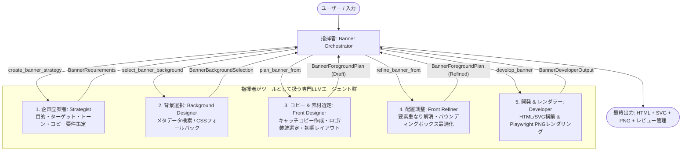

[English](README.en.md) | **日本語**

# Intentionally Retrofitted BannerAgency

OpenAIのLLMを搭載した複数の専門エージェントを指揮者（Orchestrator）がツールとして順次呼び出し、協調して高品質な広告バナー（**HTML / SVG / 高解像度PNG**）を自動生成するマルチエージェント制作システムです。

* 本システムは、BannerAgencyを実装しつつも、**意図的に画像生成AI（T2I）の利用を回避**し、既存アセットのメタデータ検索および洗練されたCSS/SVGレイアウトを活用した**ベクター＆HTMLファースト**のバナー生成パイプラインを実装しています。

---

## 1. システム概要とアーキテクチャ

本システムは、論文 **"BannerAgency: Advertising Banner Design with Multimodal LLM Agents"** の設計思想に基づきつつも、**画像生成AI（T2I）の利用を回避するという特定の環境下**でバナー制作を行うためのマルチエージェントシステムです。
既存アセットのメタデータ検索および洗練されたCSS/SVGレイアウトを活用した**ベクター＆HTMLファースト**のバナー生成パイプラインを実装しています。
Human-in-the-loopとして、人がAIエージェントの動作を監視するだけでなく、自らバナーを修正・制作する機能を設けています。



### 各エージェントの役割
1. **指揮者 (`orchestrator`)**: ユーザーからのバナー作成依頼を受け取り、専門エージェントをツールとして順次呼び出し、各イテレーションの生成結果を統合。
2. **企画立案者 (`strategist`)**: 広告の目的、ターゲット層、トーン＆マナー、必須コピー要件を定義。
3. **背景画像選択 (`background_designer`)**: `assets/backgrounds` 内のメタデータJSONを検索して最適な背景画像を選定（画像がない場合は洗練されたCSSグラデーションを設計）。
4. **キャッチコピー＆素材選定 (`front_designer`)**: メインコピー（キャッチコピー）、サブコピー、CTAボタン、ロゴ選定、装飾バッジ選定、初期レイアウトを策定。
5. **素材配置調整 (`front_refiner`)**: 各要素の座標・サイズ・重なり（overlap）を検知・解消し、バウンディングボックス内に最適配置。
6. **開発・レンダラー (`developer`)**: エディタブルなHTML/CSSバナーおよびSVGバナーを出力し、Playwrightによる高解像度PNG画像化を実行。

---

## 2. 主な特徴

- **マルチフォーマット出力 (HTML / SVG / PNG)**:
  Web表示用のHTMLだけでなく、ベクター編集可能なSVG、プレビュー・配信用の高解像度PNGを同時に自動出力します。
- **Base64 Data URI による完全なポータビリティ**:
  ローカル画像・ロゴ・装飾アセットはすべて Base64 Data URI として HTML / SVG にインライン埋め込みされるため、CORS制限や相対パス崩れを起こさずスタンドアロンで閲覧可能です。
- **2パス衝突解決ガードレール**:
  ロゴと装飾バッジの重なり防止、縦方向に並ぶテキスト要素（メインコピー、サブコピー、CTA）の物理的な文字被りをレンダラー内部で自動検知・解消。
- **直近編集ファイルの自動検出 & スマートな `Render`**:
  出力された HTML や SVG をエディタで直接手動編集した後、対話メニューで `Render` を実行するだけで、**直近で更新されたファイルを自動検出**して即座に PNG プレビューを再生成します。ただし、**デフォルトではrequirements.txt内でplaywrightが有効になっていない**ため、PNGのレンダリングを行いたい場合は有効化して下さい。
- **本Githubに用意したサンプルアセット**:
  セール、テック、オーガニック、ラグジュアリーの用途に対応した背景（5種）、ロゴ（4種）、装飾バッジ（4種）を格納しています。

---

## 3. セットアップ手順

### 1. 仮想環境の作成とライブラリインストール
```bash
# 仮想環境の作成
python3 -m venv .venv

# 仮想環境の有効化
source .venv/bin/activate  # macOS / Linux
# Windowsの場合: .venv\Scripts\activate

# 依存ライブラリのインストール
pip install -r requirements.txt
```

### 2. 環境変数（LLM APIキー）の設定
`.env.example` をコピーして `.env` を作成し、LLM APIキーを記載します。
```bash
cp .env.example .env
```

`.env` の内容：
```env
LLM_API_KEY=your_api_key_here
# オプション: モデル指定 (OpenAI: gpt-4o, Gemini: gemini-3.8-flash, gemini-2.5-flash 等)
# LLM_MODEL=gpt-4o
# オプション: エンドポイントURL (Geminiモデル指定時は自動設定されます。Ollama等のローカル/他社利用時に指定)
# LLM_BASE_URL=https://generativelanguage.googleapis.com/v1beta/openai/
# オプション: PlaywrightによるPNG画像化のデフォルトON/OFF (true/false)
# ENABLE_PLAYWRIGHT_RENDER=false
```

### 3. （推奨）Playwright ブラウザのインストール
PNGプレビュー画像の自動レンダリングを行うためにインストールします（HTML/SVGファイルのみ利用する場合はスキップ可能です）。
```bash
playwright install chromium
```

---

## 4. 実行方法

### 対話型モードでの実行
```bash
python src/main.py
```
実行すると、バナーの目的、サイズ、PlaywrightによるPNG画像生成の有無を入力後、マルチエージェントによる自動生成が開始されます。

#### レビュー対話アクション
各イテレーション完了後、以下のレビュー操作が可能です：

| アクション | 説明 |
| :--- | :--- |
| **`OK` / `approve`** | 現在のバナーを承認し、制作を完了します。 |
| **`Comment` / `c`** | 修正指示（例：「コピー同士のマージンを広げて」「CTAボタンを黄色に」など）を入力し、エージェントによる次イテレーション（再設計）を実行します。**最小差分変更がデフォルト**となっており、指示のないロゴやコピー、装飾、背景はそのまま厳格に維持されます。 |
| **`Render` / `r`** | **直近で編集された HTML または SVG ファイルを自動検出**し、LLMを介さずに PNG プレビューを即座に再生成します。（`render banner_iter2.svg` のようにファイル名を直接指定することも可能） |
| **`Exit` / `quit`** | バナー制作を中断・終了します。 |

### コマンドライン引数での直接実行
```bash
# 基本実行 (対話型レビューモード)
python src/main.py --objective "春の新生活応援キャンペーン セールバナー" --width 300 --height 250
python src/main.py --objective "年金は将来もらえるの?? コラム掲載告知 コラムの概要を伝える記述付き" --width 300 --height 700
python src/main.py --objective "AI SaaS ツールの新規ユーザー獲得" --width 300 --height 250

# 英語テーマ名を直接指定（未指定時はobjectiveから自動生成されます）
python src/main.py --objective "春の新生活応援キャンペーン セールバナー" --theme spring_sale --width 300 --height 250

# PlaywrightによるPNGプレビューも有効化
python src/main.py --objective "セキュリティソフト セールバナー" --width 300 --height 250 --render-png

# 非対話型（1イテレーションで自動終了）
python src/main.py --objective "AI SaaS ツールの新規ユーザー獲得" --non-interactive

# 過去案件の再編集（フォルダ名またはパスを指定）
python src/main.py --resume 20261111_213459_ai_saas_acquisition
python src/main.py --resume artifacts/output/banners/20261111_213459_ai_saas_acquisition
```

※ 引数なし（`python src/main.py`）で起動した場合も、直近の案件一覧が表示され番号で選択して再編集できます。

---

## 5. 各エレメントの装飾仕様・作成＆変更指示ガイド

本システムでは、背景・ロゴ・装飾バッジおよび各テキスト／CTAエレメント（`BannerForegroundElement`）に対して、座標・サイズだけでなく多彩なCSS装飾を施すことができます。

### 5.1 エレメント別の可能な装飾・表現一覧

| エレメント種別 (`role` / `type`) | 主な役割 | 適用可能な装飾・デザイン表現 |
| :--- | :--- | :--- |
| **背景 (`background`)** | キャンバス全体のベース背景 | ・**SVG背景アセットの選択**（全10種：`spring_sale`, `tech_blue`, `warm_sunset`, `natural_mint`, `luxury_dark`, `cyber_neon_dark`, `clean_minimal_white`, `summer_ocean_blue`, `autumn_harvest`, `vibrant_pop_yellow`）<br/>・**マルチレイヤーCSSグラデーション**（アセット不使用時：`radial-gradient` の光彩＋多段 `linear-gradient` の組み合わせや単色背景） |
| **ブランドロゴ (`logo` / `logo_text`)** | ブランド象徴・サービス名表記 | ・**ロゴ画像 (`logo_asset_path`)**: 左上（`x=12, y=12`）へのSVGロゴ配置（全9種：`circle`, `shield`, `leaf`, `hex`, `flame`, `diamond`, `infinity`, `wing`, `cube`）<br/>・**ロゴ横テキスト (`role: logo_text`)**: フォント（`font_family`）、太さ（`font_weight`）、字間（`letter_spacing`）、文字色（`color`）、テキストシャドウ（`text_shadow`）の指定、またはテキスト削除 |
| **メインコピー (`role: main_copy`)** | 最も視線を集めるキャッチコピー | ・**意図的な改行 (`\n`)**: `white-space: pre-line` により指定位置での美しい改行リズムを維持<br/>・**フォント切り替え (`font_family`)**: 明朝・セリフ体（高級感・和風・エディトリアル）、モダンゴシック体（テック・BtoB）、丸ゴシック体（ポップ・親しみやすさ）<br/>・**文字シャドウ・発光 (`text_shadow`)**: ドロップシャドウ（`0 2px 10px rgba(0,0,0,0.45)`）やネオングロウ表現<br/>・**字間調整 (`letter_spacing`)**: `0.04em`〜`0.08em` 等のカーニング調整<br/>・**ハイライト帯背景 (`background`, `border_radius`, `border`)**: 見出しの背面に色帯や角丸ボックスを敷く表現（自動で左右パディング `2px 8px` が付与） |
| **サブコピー / 注記 (`role: body_copy` / `note`)** | 補足訴求・実績数値・条件注記 | ・**複数行・行揃え (`align`)**: `left` / `center` / `right`、文字サイズ、色、ウェイト、字間調整<br/>・**ピル型タグラベル / バッジ化**: `background`（半透明 `rgba(255,255,255,0.16)` やアクセントカラー）＋ `border_radius: 12~20` ＋ `border`（細枠線）＋ `box_shadow` を組み合わせ、「導入1,500社突破」「期間限定」などをカプセル型ラベルとしてデザイン可能 |
| **CTAボタン (`type: cta`, `role: cta`)** | クリック・行動を促すボタン | 下記「**5.2 CTAボタンで可能なデザイン表現の詳細**」を参照 |
| **装飾バッジ (`type: decorative`, `role: decorative`)** | キャンペーン感・アイキャッチの付与 | ・**SVG装飾バッジの配置**（全9種：`ribbon_badge`, `discount_burst_badge`, `new_tag_ribbon`, `special_crown_badge`, `limited_time_clock_badge`, `free_shipping_truck_badge`, `point_back_coin_badge`, `guarantee_trust_badge`, `hot_flame_badge`）<br/>・ロゴがある場合は衝突回避ガードレールにより自動的に右上エリアへ最適配置 |

---

### 5.2 CTAボタンで可能なデザイン表現の詳細

CTAエレメント（`type="cta"`, `role="cta"`）は以下の5軸を自由に組み合わせてデザインできます。

1. **形状・シェイプ（`border_radius`, `width`, `height`）**
   - **ピル型（カプセルボタン）**: `border_radius: 20`〜`99`（モダンSaaS・キャンペーン系）
   - **角丸レクタングル**: `border_radius: 6`〜`12`（コーポレート・BtoB・誠実なトーン）
   - **シャープ長方形**: `border_radius: 0`〜`2`（ラグジュアリー・ハイブランド・和風）
   - **ボタン幅**: バナー幅いっぱいのワイドボタンから、左右どちらかに寄せたコンパクトボタンまで調整可能。
2. **背景・塗り（`background`）**
   - **フラット単色**: `#2563eb`、`#ef4444` などの高コントラストソリッドカラー
   - **リニアグラデーション**: `linear-gradient(135deg, #00f2fe 0%, #4facfe 100%)`（テック系）、`linear-gradient(90deg, #f59e0b 0%, #ef4444 100%)`（セール系）など
   - **メタリック／グロス調グラデーション**: `linear-gradient(180deg, #fde68a 0%, #d97706 50%, #b45309 100%)`（ゴールド調など上下の明暗差による立体表現）
   - **半透明・グラスモーフィズム風**: `rgba(255, 255, 255, 0.18)`（背景を透かすガラス調ボタン）
   - **完全透過（ゴーストボタン用）**: `transparent`（`border` と併用）
3. **立体感・発光エフェクト（`box_shadow`）**
   - **フローティング（浮き上がりドロップシャドウ）**: `0 4px 14px rgba(0, 0, 0, 0.3)`
   - **カラーグロウ／ネオン発光**: `0 0 16px rgba(0, 242, 254, 0.65)`
   - **押しボタン風（3Dハードシャドウ）**: `0 4px 0 #991b1b`（ぼかし0pxで物理ボタンの厚みを表現）
   - **インナーハイライト重ね掛け**: `inset 0 1px 0 rgba(255,255,255,0.45), 0 4px 10px rgba(0,0,0,0.25)`
4. **枠線・リム表現（`border`）**
   - **ゴーストボタン（アウトラインCTA）**: `background: "transparent"` ＋ `border: "2px solid #ffffff"`
   - **ガラスエッジ（半透明枠）**: `border: "1px solid rgba(255, 255, 255, 0.4)"`
   - **ゴールドリム／二重枠線**: `border: "1px solid #fbbf24"` や `border: "3px double #d4af37"`
5. **タイポグラフィ・テキスト表現（`text`, `font_family`, `letter_spacing`, `text_shadow`, `color`）**
   - **矢印・記号の組み合わせ**: `まずは無料で試す →`、`今すぐチェック ▶`、`限定特典を受け取る ≫`
   - **2行構成CTA**: `\n` を含めることで「`【初回限定】\n今すぐ無料で試す →`」のような2段組ボタンも表現可能
   - **フォント・字間・文字シャドウの継承**: ボタン内の `<button>` は親要素の `font_family`, `letter_spacing`, `text_shadow` をそのまま継承します。

---

### 5.3 初回作成時（`--objective` / `--notes`）の効果的な指示の出し方

初回生成（Iteration 1）から狙い通りのクリエイティブを得るには、`--objective` で「何の広告か」を伝え、`--notes` で「レイアウト構図・フォント感・配色・CTAの質感」を指定するのが効果的です。

```bash
# 例1: 高級感のある明朝体＋ゴールド枠ゴーストボタンのバナー
python src/main.py \
  --objective "会員制プレミアムスパ 初回体験キャンペーン" \
  --notes "ダークラグジュアリー調。メインコピーは明朝体(serif)で字間を広めに。CTAは角丸なしのゴールド枠ゴーストボタンにして高級感を出す" \
  --width 300 --height 250

# 例2: テック系・左寄せ構図＋ピル型バッジ＋シアン発光CTA
python src/main.py \
  --objective "次世代AIコードレビューツールの無料トライアル獲得" \
  --notes "左寄せのエディトリアルレイアウト。サブコピーは半透明ガラス風のピル型ラベルにし、CTAはシアン〜ブルーのグラデーション＋発光シャドウ(box-shadow)で立体的に" \
  --width 300 --height 250

# 例3: 横長バナー（728x90）での左右スプリット配置
python src/main.py \
  --objective "クラウド会計ソフト 乗り換えキャンペーン" \
  --notes "横長サイズに合わせて左側にメインコピーとサブコピー、右側に立体的なオレンジグラデーションのCTAボタンを配置する左右分割レイアウト" \
  --width 728 --height 90
```

---

### 5.4 レビュー対話時（`Comment` / `c`）の変更指示レシピ

イテレーション2以降の `Comment` では、**最小差分変更ガードレール**が働くため、「変更したい要素と内容」だけをピンポイントに指示してください（言及しなかった背景・ロゴ・他テキストは自動的に保護されます）。

#### 💬 コピー・改行・フォントの変更指示
- `「メインコピーを『定型業務をAIで自動化\n生産性を飛躍的に向上』の2行に変更して」`
- `「メインコピーのフォントを明朝体（serif）に変えて、字間（letter-spacing）を少し広げて」`
- `「メインコピーに黒系のドロップシャドウ（text-shadow）をつけて背景から際立たせて」`
- `「ロゴ横の『WorkAI』というテキスト要素は削除して」`

#### 💬 サブコピー・注記のあしらい（ピル型ラベル化など）の変更指示
- `「サブコピーに半透明の白背景と細い白枠（border）、角丸（border-radius: 14px）をつけてピル型バッジ風にして」`
- `「注記（note）の文字色をもう少し明るいグレー（#e2e8f0）にして読みやすくして」`

#### 💬 CTAボタンのデザイン変更指示
- `「CTAボタンを黄色〜オレンジのグラデーションに変更し、ドロップシャドウ（box-shadow）をつけて立体的にして」`
- `「CTAを押しボタン風の3Dシャドウ（0 4px 0 #b45309）がついたカプセル型ボタンにして」`
- `「CTAボタンの背景を透明（transparent）にして、2pxの白枠がついたゴーストボタンに変更して」`
- `「CTAの文言を『無料で試す →』に変えて、バナーの最下部中央に配置して」`

#### 💬 レイアウト・配置・余白の調整指示
- `「メインコピーとサブコピーの縦のマージンを広げて、文字が詰まって見えないようにして」`
- `「メインコピーをバナーの中央（縦横センター）に配置し、CTAを下部に配置して」`
- `「テキスト全体を左揃え（align: left）にして、左側に寄せて配置して」`

#### 💬 背景・ロゴ・装飾バッジの変更指示
（※これらは明示的にキーワードを含めて指示した場合のみ変更が許可されます）
- `「背景（background）を warm_sunset_bg に変更して」`
- `「背景画像を使わず、紺色からシアンへ変化するCSSグラデーション背景に変更して」`
- `「右上に割引バッジ（discount_burst_badge）の装飾を追加して」`
- `「ブランドロゴを盾マーク（brand_logo_shield）のロゴに変更して」`

---

## 6. 出力ファイル構造

生成された成果物は `artifacts/output/` に保存されます。出力フォルダの名称はタイムスタンプと簡潔な英語テーマ名を組み合わせた `yyyymmdd_hhmmss_theme` 形式で固定されます。

```text
artifacts/
├── output/
│   ├── banners/
│   │   └── <banner_id>/              # セッション固有の出力フォルダ（例: 20261110_221238_spring_sale）
│   │       ├── banner.html           # 最新イテレーションのHTMLバナー（ブラウザで再読み込み可能）
│   │       ├── banner.svg            # 最新イテレーションのSVGバナー
│   │       ├── banner.png            # 最新イテレーションの高解像度PNGプレビュー
│   │       ├── banner_iter1.html     # イテレーション1の履歴
│   │       ├── banner_iter1.svg
│   │       ├── banner_iter1.png
│   │       ├── banner_iter2.html     # イテレーション2の履歴
│   │       └── ...
└── graph/
    └── banner_graph_<banner_id>.md   # Mermaid形式のエージェント実行フロー可視化グラフ
```

---

## 7. アセットの構成と追加方法

`assets/` ディレクトリ配下に、画像ファイル（SVG / PNG / JPG）と同名の `.json` メタデータファイルを配置することで、エージェントが自動的に検索・選定できるようになります。

```text
assets/
├── backgrounds/         # 背景素材（spring_sale, tech_blue, warm_sunset, natural_mint, luxury_dark 等 全10種）
├── logos/               # ロゴ素材（circle, shield, leaf, hex, flame, diamond, infinity, wing, cube 全9種）
└── decorations/         # 装飾バッジ（ribbon, discount_burst, new_tag, special_crown 等 全9種）
```

**メタデータ JSON の例 (`assets/backgrounds/warm_sunset_bg.json`):**
```json
{
  "id": "warm_sunset_bg",
  "name": "Warm Sunset Energy Gradient",
  "category": "background",
  "theme": "sale, campaign, vibrant, energetic, warm, orange, red, sunset",
  "description": "A dynamic and vibrant warm sunset gradient with energetic glowing accents, perfect for urgent promotions.",
  "recommended_mood": "energetic, passionate, urgent, warm, vibrant",
  "dimensions": {
    "width": 1200,
    "height": 1000
  }
}
```

---

## 8. テストの実行

```bash
# 仮想環境内でテストを実行
.venv/bin/pytest
# または
pytest
```
アセット読み込み、HTML/SVG生成、Base64 Data URI埋め込み、衝突解消ガードレール、直近編集ファイルの自動検出レンダリングなど全テストのパスを確認できます。

---

## 9. 引用・参考文献

本プロジェクトは以下の論文およびリポジトリの設計思想を参考にしています：
- **Paper**: [arXiv:2503.11060](https://arxiv.org/abs/2503.11060)
- **Official Repository**: [sony/BannerAgency](https://github.com/sony/BannerAgency)
- **Project Page**: [https://banneragency.github.io/](https://banneragency.github.io/)

```bibtex
@inproceedings{wang2025banneragency,
  title     = {BannerAgency: Advertising Banner Design with Multimodal LLM Agents},
  author    = {Wang, Heng and Shimose, Yotaro and Takamatsu, Shingo},
  booktitle = {Proceedings of the 2025 Conference on Empirical Methods in Natural Language Processing (EMNLP)},
  year      = {2025}
}
```

---

## 10. ライセンス

本プロジェクトは [MIT License](LICENSE) のもとで公開されています。
